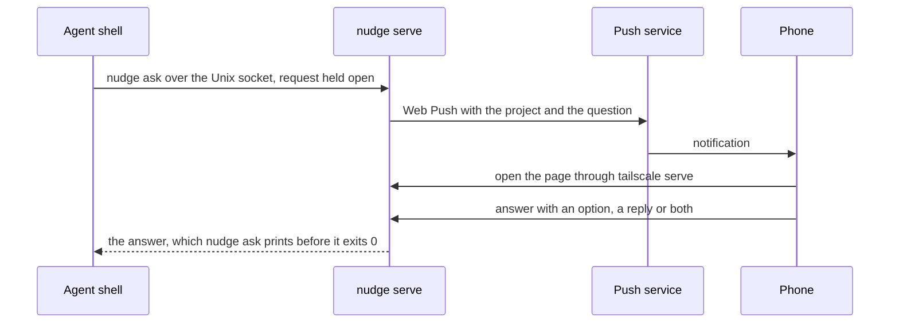

# nudge work plan

Version 1.0, 2026-10-24.

nudge lets a coding agent ask its user a question on the phone and wait for the answer. The agent runs `nudge ask` in its shell. The phone shows a notification, the user picks an option or types a reply in a small web app, the answer prints in the agent's shell, and the agent carries on.

This document is the source of truth for scope and the work breakdown. How we work (rules, pipeline, quality gates) is canonical in [AGENTS.md](../AGENTS.md). Update the status markers as work lands.

**Contents**

0. [Status](#0-status)
1. [Goal and scope](#1-goal-and-scope)
2. [Facts](#2-facts)
3. [Design](#3-design)
4. [Decisions](#4-decisions)
5. [Risks](#5-risks)
6. [Open questions](#6-open-questions)
7. [Sources](#7-sources)

## 0. Status

| Id | Step | Status |
| --- | --- | --- |
| `agents-md` | AGENTS.md, this plan and the README | Done (#1) |
| `ci-baseline` | CI with mise, SonarQube Cloud and jactionlint; Renovate came with its onboarding pull request (#2) | Done (#4) |
| `go-toolchain` | The Go module, golangci-lint with the gates, the coverage gate and `mise run check`, with the first package: a question, its answer and the wait between them | Done (#5) |
| `agent-door` | `nudge serve` on the agent socket: a question waits there for its answer as long as its request | Done (#6) |
| `ask-cli` | `nudge ask`; check that a `nudge ask` that has moved to the background wakes the agent when it ends (risk 1) | Done (#7) |
| `phone-door` | `nudge serve` opens the phone door behind the Tailscale lock, with a page that lists the pending questions; `docs/setup.md` for `tailscale serve` | Done (#8) |
| `answer-form` | The answer forms on the page and `POST /questions/{id}/answer`, with `http.CrossOriginProtection` and the security headers | Done (#9) |
| `page-style` | The page's CSS, in Bakhyard's look with system fonts (decision 9) | In review (#10) |
| `pwa` | The manifest, the icons, `theme-color` and the safe areas, so the iPhone can add nudge to its Home Screen | |
| `push-subscribe` | The service worker, a button that turns notifications on, the subscriptions file, the VAPID key, and the web gates | |
| `push-send` | A Web Push for each new question; a tap opens it; gone devices are forgotten; tried on the iPhone and the Mac (risk 2) | |
| `launchd` | `nudge serve` as a launchd agent, and `nudge` on the agent's `PATH` | |
| `agent-rule` | The agent's rule to ask every question through `nudge ask` | |

**Ideas**: answer Copilot CLI's permission prompts from the phone; a button that declines a question; several questions in one `nudge ask`; a history of answers; a notification that repeats until it's answered.

## 1. Goal and scope

- For one person, on the Mac where their coding agent runs. The agent is GitHub Copilot CLI today; any agent with a shell can use nudge.
- Every question the agent has for the user goes through nudge, whether the user is at the Mac or away (decision 2).
- A question has a short text, optional details and optional options. The answer is an option, a typed reply, or both.
- Notifications go to the iPhone's Home Screen app and to a browser on the Mac, through Web Push. Tailscale carries the traffic and says who is asking.
- Out of scope: other users, other machines, a native app, a chat, and an answer history.

## 2. Facts

Checked on 2026-10-24.

1. **Copilot CLI remote control.** `/remote on`, or `"remoteSessions": true` in `~/.copilot/settings.json`, lets the user steer a running session from GitHub.com or GitHub Mobile: answer questions, approve permission requests and plans, and send prompts. The docs don't say that a question sends a push notification. When the Copilot seat comes from an organisation, its "Store local sessions in the Cloud" policy must be "View and control", which is not the default.
2. **Copilot CLI hooks.** The `notification` hook fires when the agent asks the user something (`elicitation_dialog`) or needs a permission (`permission_prompt`), but it is fire-and-forget and can't answer. A `preToolUse` hook on `ask_user` can only allow the call, deny it with a reason, or change its arguments. Command hooks time out after 30 s by default, the docs give no maximum, and a timeout lets the call through.
3. **The agent's shell.** Copilot CLI's shell tool waits at most 600 s for a command in the foreground. After that, the command keeps running in the background, and the agent is told when it ends. That message wakes an agent that has ended its turn: in a test, `sleep 50` moved to the background after a 30 s wait, the agent ended its turn, and the message started a new turn by itself when the command ended.
4. **Web Push on the iPhone and the Mac**, from Bakhyard's spike (codedogapp/bakhyard `docs/plan.md` §2). Only a Home Screen web app can subscribe on the iPhone; a Safari tab has neither `PushManager` nor the Notification API. Through `tailscale serve` and its valid certificate, `web.push.apple.com` answered 201 in about 170 ms, and the notification showed 0.4–1 s later, with the app open, in the background or closed; a tap opens the app. Safari on the Mac gets them too; Brave only with "Use Google services for push messaging" on.
5. **webpush-go** v1.4.0 (2025-01-02) is its newest release; the repo is active and not archived. From the same spike: its JWT always expires after 12 h, it prepends `mailto:` unless the subscriber starts with `https:`, and it pads payloads to 4,096 bytes.
6. **`tailscale serve`** (Tailscale 1.104.2) serves HTTPS on another port of the machine's tailnet name with `--https=<port>`, and under a name of its own with `--service` (Tailscale Services, not tried).
7. **Origins and cookies.** Browsers keep service workers, storage and push subscriptions per origin, and the port is part of the origin. Cookies ignore the port (RFC 6265 §8.5). An app on its own port of the same name gets its own service worker, push subscriptions and Home Screen app, and receives the cookies of the apps on the other ports.
8. **Unix sockets on macOS.** `connect(2)` needs write permission on the socket's path (`man 4 unix`), so file permissions decide who can use a socket.

## 3. Design

- **`nudge ask [--option TEXT]... [--details TEXT] QUESTION`** sends the question, with the name of the current directory as its project, through the agent socket. It waits for the answer, prints it as an `option: …` line and a `text: …` line, each only when it has a value, and exits 0. It exits 1 on an error, for example when the server isn't running or stops, and 2 on a usage error. When it ends early (Ctrl-C, or killed), the question goes away.
- **`nudge serve`** is one process with two doors (decision 4):
  - The **agent door** is a Unix socket, `~/Library/Application Support/nudge/agent.sock`, in a folder with mode 0700: `nudge serve` makes the folder, and refuses one that others can open; `NUDGE_SOCKET` overrides the path. `POST /questions` holds the request open until the answer arrives or the client leaves, so a question lives exactly as long as its request (decision 5).
  - The **phone door** is `127.0.0.1:8700` (`NUDGE_LISTEN` overrides it), which `tailscale serve --bg --https=8443 8700` publishes as `https://<mac>.<tailnet>.ts.net:8443` (decision 7). Every request needs the `Tailscale-User-Login` header that `tailscale serve` adds, equal to `NUDGE_LOGIN` from `mise.local.toml`, and a `Host` that is `NUDGE_HOST` once its port is dropped (decision 8); anything else gets 403. No cookies and no sign-in.
- **The page.** `GET /` lists the pending questions, newest first, each with its project, text and details, a button per option and a box for a reply. `POST /questions/{id}/answer` answers one and redirects back to the list. An option's button sends the reply in the box along with it; "Send the reply" sends the reply alone. A refused answer shows the list again with the reason: 404 when the question has gone (answered, or its agent stopped waiting), 400 for an empty answer, an option the question doesn't offer, or a form over 64 KiB. The server renders the HTML (decision 6), and `http.CrossOriginProtection` guards the forms. Behind the lock, every response has a Content Security Policy that allows nothing but the page's stylesheet and its grain, and posting forms to the page itself (`default-src 'none'; style-src 'self'; img-src 'self'; base-uri 'none'; form-action 'self'; frame-ancestors 'none'`), `X-Content-Type-Options: nosniff` and `Referrer-Policy: same-origin`; browsers don't store the page (`Cache-Control: no-store`). An answered question leaves the list.
- **The look** (decision 9): Bakhyard's colour tokens, paper grain, cards and buttons, with system fonts: `system-ui` for text, and a monospace stack for labels and buttons. The OS picks light or dark. Each question is a card with its project as a label, its text as the title, and its details with their line breaks kept; the options are secondary buttons and "Send the reply" the primary one. `GET /style.css` and `GET /grain.svg` serve the two embedded files with `Cache-Control: no-cache`, so a new binary's look shows at once.
- **Push.** Each new question sends a Web Push to every subscribed device, titled with the project, with the question as its text; a tap opens the question on the page. The VAPID private key lives in the login Keychain (service `nudge`, account `vapid-private-key`). The subscriptions live in `~/Library/Application Support/nudge/subscriptions.json`, mode 0600, the only state on disk. A device is forgotten when its push service answers 404 or 410.
- **Running.** A launchd agent starts `nudge serve` at login and restarts it if it stops. The Mac must stay awake while the agent works: Copilot CLI's `/keep-alive on`. A MacBook on battery still sleeps when its lid closes.
- **The agent's rule** (step `agent-rule`): ask every question through `nudge ask`, in the shell, in the foreground, with the longest wait. When the command moves to the background, end the turn and say so; its end brings the answer.

## 4. Decisions

1. **Our own app, with an explicit command**: the user's choice. Not Copilot CLI's remote control, which is GitHub's own app, doesn't document a push on a question, and needs an organisation policy for an organisation seat (fact 1). Not a hook on `ask_user`, which can't answer the question cleanly (fact 2). A command works with any agent that has a shell.
2. **Always through nudge**: the user's choice. Every question goes to the phone and to the Mac's browser, also when the user is at the Mac. No away mode and no idle detection.
3. **`codedogapp/nudge`, public, with Bakhyard's pipeline and gates**: the user's choices.
4. **Two doors, two locks**. Agents use a Unix socket that only the user can open (fact 8); the phone uses `tailscale serve` with the user's Tailscale login, like Bakhyard's first lock. Local processes are trusted (risk 5).
5. **A question lives as long as its request**: no polling, no store, nothing to clean up. When the server stops, `nudge ask` fails and the agent asks again.
6. **The server renders the pages**: the forms work without JavaScript, and the Go tests cover them. JavaScript only where Web Push needs it.
7. **An origin of its own**: port 8443 of the Mac's tailnet name (fact 7). nudge gets its own service worker, push subscriptions and Home Screen app, next to Bakhyard on port 443. It ignores the Bakhyard cookie it receives.
8. **A `Host` check keeps out DNS rebinding**, as in Bakhyard's lock: the phone door also needs the request's `Host`, without its port and in any case, to be `NUDGE_HOST`. A browser sends the name from its address bar, so a page that rebinds its own name to 127.0.0.1 is refused. `tailscale serve` passes the browser's `Host` on to a TCP backend, `:8443` included (checked live in `phone-door`), but sends `localhost` to a Unix socket (`ipn/ipnlocal/serve.go` in Tailscale 1.104.2). So the phone door stays on TCP: a socket would lose the name.
9. **Bakhyard's look, with system fonts**: the user's choice. The page takes the tokens, cards, buttons and paper grain of Bakhyard's visual identity (its plan §7), so the two apps look like siblings, but no font files: system fonts keep nudge one small binary with nothing else to load.

## 5. Risks

1. **The wake-up** (fact 3) was tried with `sleep`, then with `nudge ask` in `ask-cli`: the command moved to the background after a 30 s wait, the agent ended its turn, and when the command ended 73 s after it started (its `nudge serve` stopped), the message started a new turn by itself. Fallback, if a later Copilot CLI drops it: the rule makes the agent wait in a loop, which costs a model call per round.
2. **Web Push on port 8443** hasn't been tried on the iPhone. Checked in `push-send`. Fallback: a Tailscale Service name (fact 6).
3. **A sleeping Mac** stops the agent and nudge, so the phone gets nothing new.
4. **Push is best effort**: a notification can come late or not at all. The page always lists every pending question.
5. **Local processes** can reach `127.0.0.1:8700` with a forged `Tailscale-User-Login` header and answer a question. They are trusted, as in Bakhyard. A web page in a browser on the Mac could try the same through DNS rebinding; the `Host` check refuses it (decision 8).
6. **Floating tool versions**: mise tools use `latest` with no lockfile, so a new release (for example, a new jactionlint rule) can turn CI red with no change in the repo. A local run may also use an older version than CI until `mise upgrade --local`. When CI turns red for no reason, check the tool versions first.

## 6. Open questions

1. The web gates for the JavaScript: Biome for lint and format, and how to test the service worker and measure its coverage. Decided in `push-subscribe`.
2. How the VAPID key gets into the Keychain: a `security` command in `docs/setup.md`, or `nudge serve` making it on its first start. Decided in `push-subscribe`.
3. How `nudge` gets onto the agent's `PATH`: `go install` or mise. Decided in `launchd`.
4. Where the agent's rule lives: the user's global instructions for Copilot CLI, or each repo's AGENTS.md. Decided in `agent-rule`.

## 7. Sources

- [Steering a GitHub Copilot CLI session from another device](https://docs.github.com/en/copilot/how-tos/copilot-cli/use-copilot-cli/steer-remotely) and [About remote control](https://docs.github.com/en/copilot/concepts/agent-capabilities/agent-powered-workflows-and-operations/about-remote-control) (fact 1).
- [GitHub Copilot hooks reference](https://docs.github.com/en/copilot/reference/hooks-reference) (fact 2).
- Copilot CLI 1.0.98: its shell tool's description, and the test on 2026-10-24 (fact 3).
- [codedogapp/bakhyard `docs/plan.md` §2](https://github.com/codedogapp/bakhyard/blob/main/docs/plan.md#2-feasibility) (fact 4).
- [SherClockHolmes/webpush-go](https://github.com/SherClockHolmes/webpush-go) (fact 5).
- `tailscale serve --help` (fact 6).
- Tailscale 1.104.2 [`ipn/ipnlocal/serve.go`](https://github.com/tailscale/tailscale/blob/v1.104.2/ipn/ipnlocal/serve.go): the `Host` that `tailscale serve` sends on (decision 8).
- [RFC 6265 §8.5](https://www.rfc-editor.org/rfc/rfc6265#section-8.5) (fact 7).
- `man 4 unix` on macOS (fact 8).
