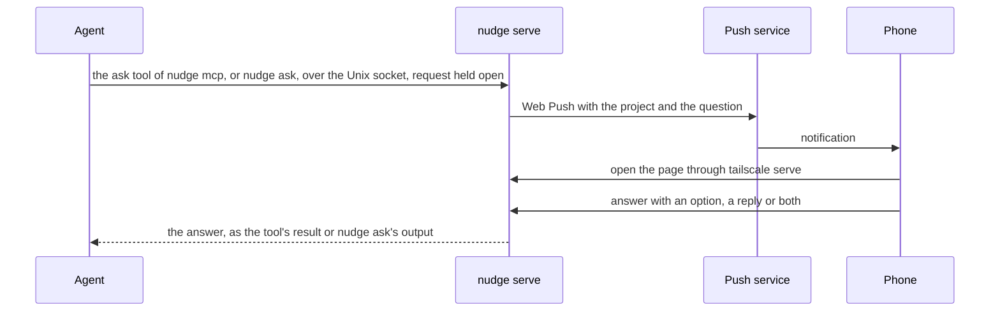

# nudge work plan

Version 1.0, 2026-10-24.

nudge lets a coding agent ask its user a question on the phone and wait for the answer. The agent calls the `ask` tool of `nudge mcp`, nudge's MCP server, or runs `nudge ask` in its shell. The phone shows a notification, the user picks an option or types a reply in a small web app, the answer goes back to the agent, and the agent carries on.

This document is the source of truth for scope and the work breakdown. How we work (rules, pipeline, quality gates) is canonical in [AGENTS.md](../AGENTS.md). Update the status markers as work lands.

**Contents**

0. [Status](#0-status)
1. [Goal and scope](#1-goal-and-scope)
2. [Facts](#2-facts)
3. [Design](#3-design)
4. [Decisions](#4-decisions)
5. [Risks](#5-risks)
6. [Open questions](#6-open-questions)
7. [Sources](#7-sources)

## 0. Status

| Id | Step | Status |
| --- | --- | --- |
| `agents-md` | AGENTS.md, this plan and the README | Done (#1) |
| `ci-baseline` | CI with mise, SonarQube Cloud and jactionlint; Renovate came with its onboarding pull request (#2) | Done (#4) |
| `go-toolchain` | The Go module, golangci-lint with the gates, the coverage gate and `mise run check`, with the first package: a question, its answer and the wait between them | Done (#5) |
| `agent-door` | `nudge serve` on the agent socket: a question waits there for its answer as long as its request | Done (#6) |
| `ask-cli` | `nudge ask`; check that a `nudge ask` that has moved to the background wakes the agent when it ends (risk 1) | Done (#7) |
| `phone-door` | `nudge serve` opens the phone door behind the Tailscale lock, with a page that lists the pending questions; `docs/setup.md` for `tailscale serve` | Done (#8) |
| `answer-form` | The answer forms on the page and `POST /questions/{id}/answer`, with `http.CrossOriginProtection` and the security headers | Done (#9) |
| `page-style` | The page's CSS, in Bakhyard's look with system fonts (decision 9) | Done (#10) |
| `pwa` | The manifest, the icons, `theme-color` and the safe areas, so the iPhone can add nudge to its Home Screen (decision 10) | Done (#11) The iPhone check (AC7) passed on 2026-10-25. |
| `vapid-key` | `nudge serve` makes its VAPID key on its first start and keeps it in the login Keychain; the page carries the public half (decision 11) | Done (#12) |
| `subscriptions` | The subscriptions file, and `POST /subscriptions` to add a device (decision 13) | Done (#13) |
| `push-button` | The service worker, a button that turns notifications on, and the web gates (decisions 12 and 14) | Done (#14) The iPhone check (AC7) passed on 2026-10-25. |
| `push-show` | The service worker shows each push as a notification, and a tap opens the page (decision 15) | Done (#15) |
| `push-send` | A Web Push for each new question; gone devices are forgotten; tried on the Mac, and on the iPhone when the user is back (decision 16, risk 2) | Done (#16) |
| `mcp` | `nudge mcp`, an MCP server whose `ask` tool asks through the agent socket, and the agent's settings in `docs/setup.md` (decision 17, risk 9) | Done (#17) |
| `release` | A `v*` tag builds `nudge` for Apple silicon and publishes it as a GitHub release with a build provenance attestation; mise installs it (decisions 18 and 20) | Done (#18), removed (#24) |
| `launchd` | `mise run launchd` writes the launchd agent that runs `nudge serve` at login, and loads it (decisions 19 and 21) | Done (#19), removed (#24) |
| `agent-rule` | The agent's rule to ask every question through nudge, in Copilot CLI's instructions (decision 22) | Done (#20) |
| `skill` | The rule becomes the `nudge` skill, which a session loads only when the user asks for it (decision 23) | Done (#21) Its AC7 passed on 2026-10-25: after the user's `/nudge`, the main Bakhyard session asked many questions through the `nudge-ask` tool, and the user answered them on the phone. |
| `settings-file` | `nudge serve` also reads its settings from a file, for a service that has no settings in its environment (decision 24) | Done (#22) |
| `version` | `nudge mcp` reports the version that the build sets with `-X main.version`, for a build from a source tarball (decision 25) | Done (#23) |
| `tap` | `codedogapp/homebrew-tap`: a formula that builds nudge from its tag's source, runs `nudge serve` with `brew services` and ships the skill, with CI (decisions 27 and 28) | Done (codedogapp/homebrew-tap#1) |
| `homebrew` | The docs install nudge with Homebrew and run it with `brew services`. The release workflow, the mise install and `mise run launchd` go: the user's choice (2026-10-25) of Homebrew only (decision 26) | Done (#24) |
| `tap-renovate` | Renovate keeps the tap's actions current, with its `homebrew` manager off (decision 29) | Done (codedogapp/homebrew-tap#2) |
| `tap-renovate-tags` | Renovate reads the whole tag of `Homebrew/actions`' releases, so it keeps setup-homebrew's pin current (decision 30) | Done (codedogapp/homebrew-tap#4) |
| `sessions` | The agent door starts a session over a held connection, `POST /sessions`, and takes its note, `PUT /sessions/{id}/note`; the server keeps the sessions and their last note in memory, and the agent door's client can register and report (decision 31) | Done (#29) |
| `report-tool` | `nudge mcp` registers a session when it starts, and its `report` tool sets the session's note (decision 31) | Done (#30) |
| `sessions-page` | The page lists the sessions under the questions (decision 31) | Done (#31) |
| `status-skill` | The skill tells the agent to report at milestones; `docs/setup.md` | Done (#32) |
| `setup-settings` | `internal/setup` writes the settings file from `tailscale status --json`, unless it exists (decision 33) | Done (#34) |
| `setup-publish` | `internal/setup` runs `tailscale serve --bg --https=8443 8700` (decision 33) | Done (#35) |
| `setup-agent` | `internal/setup` adds the MCP server and the skill to Copilot CLI, skipping what is there (decision 33) | Done (#36) |
| `setup-command` | `nudge setup` runs the three steps and prints what it did; `docs/setup.md` leads with it (decision 33) | Done (#37) |
| `agent-api` | The phone door also serves the agent door's endpoints under `/agent/`, behind the same lock (decisions 34 and 35) | Done (#41) |
| `remote-client` | `nudge ask` and `nudge mcp` use `NUDGE_SERVER`, an https URL, in place of the socket when it is set (decision 35) | Done (#42) |
| `machine-label` | A question and a session carry the machine's name, and the page shows it (decision 34); done by naming the project "project (machine)" on the client, which the page and the push title show as they are | Done (#43) |
| `vapid-file` | `nudge serve` can take its VAPID key from a file or the environment, for a host with no Keychain (decision 35); it is `NUDGE_VAPID_KEY_FILE`, with no key in the settings file | Done (#44) |
| `ingress-check` | A throwaway pod behind a `tailscale` Ingress in the homelab: does the proxy send `Tailscale-User-Login` and the Ingress's name as `Host`, and does it keep a request open for hours (risk 12). Done: the proxy sends both; a request held 330 s was answered; hours untested | Done |
| `container-image` | A Dockerfile in this repo: a static `linux/amd64` Go binary, non-root, `nudge serve` as the entrypoint. Done: it cross-compiles on the build host (QEMU crashed the Go toolchain on a Mac); 5.7 MB; ran with a read-only root and answered 200 with the login header and 403 without | Done |
| `server-setting` | A `server` key in the settings file, read by `nudge ask` and `nudge mcp` as `NUDGE_SERVER` is (decision 36). `nudge setup` doesn't write it yet; the user adds it to the settings file by hand | Done |
| `image-workflow` | `.gitea/workflows/image.yaml`: builds with BuildKit and pushes `git.tail9e9088.ts.net/codedogapp/nudge` (`:main` and `:sha-<7>` for main, `:vX.Y.Z` for a tag) from the Gitea mirror. Needs the mirror with Actions on (the user, in Gitea); untested until then | Todo |
| `k8s-manifests` | `cluster/nudge/` in the homelab repo (plain YAML, Flux): Deployment, volume, Service, Ingress, and a doc there (decision 36) | Todo |
| `cutover` | Tag v0.4.0, deploy, point the Macs and the iPhone at the cluster; after the user confirms it works, stop the Mac's `brew services` nudge and `tailscale serve` | Todo |
| `multi-device` | The steps above, together: the user's end check that a question from a second machine reaches the iPhone (decisions 32, 34 and 35) | Todo |
| `swift-spike` | A spike on a native iOS app (decision 32), findings in a docs PR | Done (#39): [swift-spike.md](swift-spike.md), desk research only |

**Ideas**: answer Copilot CLI's permission prompts from the phone; a button that declines a question; several questions in one `nudge ask`; a history of answers; a notification that repeats until it's answered; take a notification away once its question is answered; a notification that opens its own question; a Copilot CLI plugin that bundles the skill and the MCP server (whether a plugin's MCP config takes a `timeout` is unchecked).

## 1. Goal and scope

- For one person, on the Mac where their coding agent runs. The agent is GitHub Copilot CLI today; any agent with MCP or a shell can use nudge.
- When the user asks for it, every question the agent has for them goes through nudge, until they're back (decisions 2 and 23).
- A question has a short text, optional details and optional options. The answer is an option, a typed reply, or both.
- Notifications go to the iPhone's Home Screen app and to a browser on the Mac, through Web Push. Tailscale carries the traffic and says who is asking.
- Out of scope: other users, other machines, a native app, a chat, and an answer history.

## 2. Facts

Checked on 2026-10-24.

1. **Copilot CLI remote control.** `/remote on`, or `"remoteSessions": true` in `~/.copilot/settings.json`, lets the user steer a running session from GitHub.com or GitHub Mobile: answer questions, approve permission requests and plans, and send prompts. The docs don't say that a question sends a push notification. When the Copilot seat comes from an organisation, its "Store local sessions in the Cloud" policy must be "View and control", which is not the default.
2. **Copilot CLI hooks.** The `notification` hook fires when the agent asks the user something (`elicitation_dialog`) or needs a permission (`permission_prompt`), but it is fire-and-forget and can't answer. A `preToolUse` hook on `ask_user` can only allow the call, deny it with a reason, or change its arguments. Command hooks time out after 30 s by default, the docs give no maximum, and a timeout lets the call through.
3. **The agent's shell.** Copilot CLI's shell tool waits at most 600 s for a command in the foreground. After that, the command keeps running in the background, and the agent is told when it ends. That message wakes an agent that has ended its turn: in a test, `sleep 50` moved to the background after a 30 s wait, the agent ended its turn, and the message started a new turn by itself when the command ended.
4. **Web Push on the iPhone and the Mac**, from Bakhyard's spike (codedogapp/bakhyard `docs/plan.md` §2). Only a Home Screen web app can subscribe on the iPhone; a Safari tab has neither `PushManager` nor the Notification API. Through `tailscale serve` and its valid certificate, `web.push.apple.com` answered 201 in about 170 ms, and the notification showed 0.4–1 s later, with the app open, in the background or closed; a tap opens the app. Safari on the Mac gets them too; Brave only with "Use Google services for push messaging" on.
5. **webpush-go** v1.4.0 (2025-01-02) is its newest release; the repo is active and not archived. From the same spike: its JWT always expires after 12 h, it prepends `mailto:` unless the subscriber starts with `https:`, and it pads payloads to 4,096 bytes.
6. **`tailscale serve`** (Tailscale 1.104.2) serves HTTPS on another port of the machine's tailnet name with `--https=<port>`, and under a name of its own with `--service` (Tailscale Services, not tried).
7. **Origins and cookies.** Browsers keep service workers, storage and push subscriptions per origin, and the port is part of the origin. Cookies ignore the port (RFC 6265 §8.5). An app on its own port of the same name gets its own service worker, push subscriptions and Home Screen app, and receives the cookies of the apps on the other ports.
8. **Unix sockets on macOS.** `connect(2)` needs write permission on the socket's path (`man 4 unix`), so file permissions decide who can use a socket.
9. **mise's shims and install folders.** A shim, such as `~/.local/share/mise/shims/nudge`, runs mise, which reads the config files of the folder it runs in and refuses to run when one of them isn't trusted (`Config files in … are not trusted`), even one with nothing but an `[env]` table. Each tool's install folder, such as `~/.local/share/mise/installs/github-codedogapp-nudge`, keeps a `latest` symlink to its newest installed version, which mise moves when it installs a newer one. Tried with mise 2026.10.17.
10. **Go's build info.** Since Go 1.24, `go build` takes the main module's version from the git tag on the commit it builds, and adds `+dirty` when the tree has uncommitted changes; untracked files count. A build outside a git checkout, from a source tarball for example, records `(devel)`. Since Go 1.20, macOS's `net` and `os/user` packages don't use cgo, so a build with cgo off runs the same code as a native one. Go's linker signs the darwin/arm64 binaries it links with an ad hoc signature.
11. **launchd's agents.** An agent whose `KeepAlive` is true is kept running: launchd starts it when the agent loads, and again whenever it exits, but not more than once every 10 seconds (`ThrottleInterval`). launchd gives the agents it starts for the logged-in user `HOME`, `USER`, `LOGNAME`, `SHELL`, `TMPDIR` and `PATH=/usr/bin:/bin:/usr/sbin:/sbin`: seen with `ps -E` in two running agents from `/Library/LaunchAgents`. Homebrew's `brew services stop` expects `launchctl bootout` to exit with EINPROGRESS (36) while a job is still stopping, and runs it again a second later until `launchctl print` no longer finds the job.
12. **Copilot CLI's instructions.** Copilot CLI 1.0.103 gives every session the instructions in `~/.copilot/copilot-instructions.md` and in the `*.instructions.md` files under `~/.copilot/instructions/`, and in the folders that `COPILOT_CUSTOM_INSTRUCTIONS_DIRS` lists. In a repo, it reads such files only under `.github/instructions/`. A file without front matter applies everywhere: `copilot instruction list --json` shows it with no `applyTo`. A session reads them when it starts. An MCP server's own instructions reach the model only for servers on an allowlist, or with `--allow-all-mcp-server-instructions`, a flag for one run that no setting turns on. The model sees an MCP server's tool as `<server>-<tool>`, so nudge's is `nudge-ask`. An interactive session offers the model `ask_user`; prompt mode (`-p`) doesn't, as its event log shows, so only an interactive session shows whether an agent prefers nudge. In `agent-rule`'s QA, interactive sessions that had the `nudge` MCP server but no rule asked with `ask_user`.
13. **Copilot CLI's skills.** Copilot CLI 1.0.103 finds skills, each a folder with a `SKILL.md`, in a repo's `.github/skills/`, `.agents/skills/` or `.claude/skills/`, in `~/.copilot/skills/` and `~/.agents/skills/`, in plugins, and in the folders that `copilot skill add <folder>` adds to its settings. A skill's front matter gives its `name`, a `description` of what it does and when to use it, and optionally `allowed-tools`. A session loads a skill when the model judges it relevant to the prompt, or when the user starts a prompt with its name after a slash, as in `/nudge …`, which the interactive mode runs as a command; the session's event log then has a `skill.invoked` event. When a skill loads, Copilot CLI turns its `allowed-tools`, a comma-separated list or a YAML list of permission patterns, into rules approved for the rest of the session, as `--allow-tool` does. Its runtime parses `nudge(ask)` as the `ask` tool of the MCP server `nudge`, and `shell(nudge:*)` as any `nudge` command. Any other tool still asks for permission first, which the event log shows as `permission.requested`. `copilot skill add` keeps a folder's path as it's given, without resolving symlinks: in a test on 2026-10-25 with a throwaway `COPILOT_HOME`, a skill that it found through a symlink still loaded after the symlink moved to a new folder and the old one was deleted, as an upgrade does to Homebrew's `opt` link.
14. **Homebrew's taps and services**, in Homebrew 7.0.10, checked on 2026-10-25. Homebrew loads a formula from a tap other than its own only once it's trusted (`brew trust`, kept in `~/.homebrew/trust.json`); `brew install` and `brew upgrade` tap a formula's tap and trust the formula when they're given its full name, as in `codedogapp/tap/nudge`. Homebrew's own cask `nudge`, macadmins' Nudge, which enforces macOS updates, wins over a formula from another tap for a bare name: `brew install nudge`, `brew upgrade nudge` and `brew info nudge` mean the cask. `brew uninstall`, which looks for an installed formula first, `brew services` and `brew --prefix` find the formula. `brew services start` writes the formula's service as a launchd agent, `~/Library/LaunchAgents/sh.brew.<formula>.plist` (Homebrew still recognizes the older `homebrew.mxcl.<formula>`), makes its log's folder and loads it: launchd starts it at once (`RunAtLoad` is the default) and at each login. Unless the formula sets them, the service has no working directory, so launchd starts it in `/`, and no variables but those in `~/.homebrew/services/<formula>.env` (`$HOMEBREW_USER_CONFIG_HOME/services/`), a `KEY=value` file that Homebrew skips when others can write it. `brew upgrade` doesn't restart a running service; `brew services restart` does. A formula builds with `GOTOOLCHAIN=local`, so Go builds with Homebrew's `go` and never downloads another, and `brew install` upgrades a dependency that's outdated before it builds. `std_go_args` builds into the formula's `bin` with `-trimpath`, and links with `-s -w` before the formula's own `ldflags`.
15. **`brew test-bot`**, in Homebrew 7.0.10. `brew test-bot --only-formulae` tests a formula only on its way to a bottle: with `--build-from-source`, it skips the formula as "No bottle built" and still passes. Without it, it builds the formula with `--build-bottle`, checks its style, audits it online, makes a bottle on the runner, installs the bottle, checks its linkage and runs its test. The audit of a formula that the change adds also runs `--new`, homebrew-core's checks for a new formula, which a new repo fails, or `--strict` instead with `--skip-new`; the audit of a changed formula runs `--git`. In GitHub Actions, it writes the formulae it skipped or failed to its `skipped_or_failed_formulae` output. The online audit checks the GitHub release of a formula's tag only when there is one, so a tag without a release passes.

## 3. Design

- **`nudge mcp`** is an MCP server on stdin and stdout, which the agent starts and stops (decision 17). It offers two tools. `report` takes a `note`, sets the session's note and returns at once (decision 31): `nudge mcp` starts the session when it starts, if `nudge serve` is running then, else on the first report, and again when a restart has made it forget the session. `ask` takes a `question`, and optionally `options` and `details`. A call sends the question through the agent socket, as `nudge ask` does, with the name of the folder the agent started the server in as its project, and waits for the answer. The result is the answer as structured content, its `option` and its `text`, with the same JSON in a text block. An error, for example when `nudge serve` isn't running, comes back as a tool error with `nudge ask`'s message. When the agent cancels the call, closes the server's stdin, or stops it with SIGINT or SIGTERM, the question goes away. `nudge mcp` then exits 0; it exits 1 on another error, and 2 when it's given an argument. Its server info gives the agent nudge's version: the one that the build sets as `main.version`, else the one that Go's build info recorded (decision 25).
- **`nudge setup`** does a new Mac's one-time work: the settings file, `tailscale serve` and the agent's MCP server and skill, each step idempotent (decision 33). `internal/setup` holds the steps and runs the outside tools through one function; `internal/cli` wires them.
- **`nudge ask [--option TEXT]... [--details TEXT] QUESTION`** sends the question, with the name of the current directory as its project, through the agent socket. It waits for the answer, prints it as an `option: …` line and a `text: …` line, each only when it has a value, and exits 0. It exits 1 on an error, for example when the server isn't running or stops, and 2 on a usage error. When it ends early (Ctrl-C, or killed), the question goes away.
- **`nudge serve`** is one process with two doors (decision 4):
- **The tailnet door for agents**: the phone door also serves the agent door's endpoints under `/agent/` (`/agent/questions`, `/agent/sessions`), behind the same lock, for agents on other machines (decision 35). The socket stays for local agents.
  - The **agent door** is a Unix socket, `~/Library/Application Support/nudge/agent.sock`, in a folder with mode 0700: `nudge serve` makes the folder, and refuses one that others can open; `NUDGE_SOCKET` overrides the path. `POST /questions` holds the request open until the answer arrives or the client leaves, so a question lives exactly as long as its request (decision 5). `POST /sessions` starts a session for a project, replies with its ID at once and then holds the request open: the session lasts as long as the request, so it ends when the client leaves or the server stops (decision 31). `PUT /sessions/{id}/note` sets the session's note, and answers 404 for a session that has ended and 400 for an empty note.
  - The **phone door** is `127.0.0.1:8700` (the `listen` setting overrides it), which `tailscale serve --bg --https=8443 8700` publishes as `https://<mac>.<tailnet>.ts.net:8443` (decision 7). Every request needs the `Tailscale-User-Login` header that `tailscale serve` adds, equal to the `login` setting, and a `Host` that is the `host` setting once its port is dropped (decision 8); anything else gets 403. No cookies and no sign-in.
- **Settings** (decision 24): `nudge serve` takes each setting from its variable, else from its key in `~/Library/Application Support/nudge/settings.json`, else from its default, once, when it starts. An empty value counts as unset. The file is a JSON object whose keys `login`, `host`, `listen` and `subscriptions` take strings, and the last an absolute path. A missing file gives no settings; one that can't be read or isn't valid stops `nudge serve` before either door opens. `docs/setup.md` lists the settings and their variables.
- **The page.** `GET /` lists the pending questions, newest first, each with its project, text and details, a button per option and a box for a reply. Under them, a Sessions section lists the running sessions (decision 31), newest first, each as a card with its project, its last note and how long ago it made it ("just now", "5 min ago", "2 h ago", "3 d ago"), or "No report yet."; with none running it says so. The age is worked out when the page loads, so the page shows it as of the last load. `POST /questions/{id}/answer` answers one and redirects back to the list. An option's button sends the reply in the box along with it; "Send the reply" sends the reply alone. A refused answer shows the list again with the reason: 404 when the question has gone (answered, or its agent stopped waiting), 400 for an empty answer, an option the question doesn't offer, or a form over 64 KiB. The server renders the HTML (decision 6), and `http.CrossOriginProtection` guards the forms. Behind the lock, every response has a Content Security Policy that allows nothing but the page's scripts, its stylesheet, its grain, its icons and its manifest, and requests and forms to the page itself (`default-src 'none'; script-src 'self'; style-src 'self'; img-src 'self'; manifest-src 'self'; connect-src 'self'; base-uri 'none'; form-action 'self'; frame-ancestors 'none'`); the service worker falls under `script-src`, `X-Content-Type-Options: nosniff` and `Referrer-Policy: same-origin`; browsers don't store the page (`Cache-Control: no-store`). An answered question leaves the list.
- **The look** (decision 9): Bakhyard's colour tokens, paper grain, cards and buttons, with system fonts: `system-ui` for text, and a monospace stack for labels and buttons. The OS picks light or dark. Each question is a card with its project as a label, its text as the title, and its details with their line breaks kept; the options are secondary buttons and "Send the reply" the primary one. `GET /style.css` and `GET /grain.svg` serve the two embedded files with `Cache-Control: no-cache`, so a new binary's look shows at once.
- **The Home Screen** (decision 10): Safari's Share → Add to Home Screen makes the page an app, which opens without Safari's bars. The page links its icon (`/icon.svg`, and `/apple-touch-icon.png` at 180 px for iOS) and `/manifest.json` (`.json`, because Go's MIME table has no `.webmanifest`), which names the app, opens `/` in `standalone` mode and lists 192 and 512 px icons. The browser's bar takes the header's paper (`theme-color` per colour scheme), and the page keeps clear of a phone's notch and status bar (`viewport-fit=cover` with the safe-area insets). These files are embedded like the stylesheet, with `no-cache`; `mise run icons` renders the PNGs from `icon.svg` with resvg, and they are committed.
- **Push.** Each new question sends a Web Push to every subscribed device, with JSON for a payload: the project as its `title` and the question as its `body`. The service worker shows it as a notification, and a tap opens the page (decision 15). `nudge serve` reads the VAPID private key from the login Keychain (service `nudge`, account `vapid-private-key`) when it starts, and on its first start makes one and adds it there (decision 11); a key it can't read, or one that isn't valid, stops it. The page carries the public half in `<body data-push-key>`, for the browser to subscribe with when the user taps "Turn on notifications" in the header (decision 14). Its scripts, `/main.js` and `/push.js`, and the service worker, `/sw.js`, are embedded like the stylesheet, with `no-cache`. The page sends the browser's subscription, as its `toJSON()` gives it, to `POST /subscriptions`. nudge checks it: an `https` endpoint, a P-256 public key as `p256dh` and a 16-byte `auth`, both in base64url without padding. Then it adds it, or puts it in the place of the one with the same endpoint, and answers 204; an unchanged one writes nothing, because the page sends it on every visit. A body that isn't a valid subscription, or is over 4 KiB, gets 400 with the reason. The subscriptions live in `~/Library/Application Support/nudge/subscriptions.json` (the `subscriptions` setting), mode 0600, the only state on disk. Each change writes a new temporary file and renames it over the old one, so a crash leaves the old list or the new one. A file that isn't valid stops `nudge serve` (decision 13). For each new question, `nudge serve` pushes to the devices one after another, in the background, so the question doesn't wait for them (decision 16). A push lives a day on its push service (`TTL: 86400`) and asks to be delivered at once (`Urgency: high`). The title is cut to 100 characters and the body to 500, and a cut one ends in "…"; a question without a project is titled "nudge". A device is forgotten when its push service answers 404 or 410, and the log says `forgot a device`. A request that fails logs `push failed`, and any other answer logs `push refused` with its status and up to 512 bytes of its text, such as Apple's JSON `reason`. The log names the push service, never a device's endpoint. Nothing is sent again.
- **Install** (decisions 26 to 28). `brew install codedogapp/tap/nudge` installs nudge from the user's tap, `codedogapp/homebrew-tap`, whose formula builds it from its tag's source tarball with Homebrew's Go, sets the version that `nudge mcp` reports (decision 25), and installs the skill in `share/nudge/skills`. The tap's CI builds and tests each change to the formula on macOS (fact 15). The lead tags a new version after each merged step that changes the binary, then bumps the formula in a pull request to the tap. Agents start nudge through Homebrew's `opt` path, `$(brew --prefix codedogapp/tap/nudge)/bin/nudge`, which an upgrade keeps.
- **Running.** `brew services start codedogapp/tap/nudge` loads the formula's service, a launchd agent that starts `nudge serve` at once and at each login, and again when it stops (fact 14, decision 28). The service gets its settings from the settings file (decision 24). The Mac must stay awake while the agent works: Copilot CLI's `/keep-alive on`. A MacBook on battery still sleeps when its lid closes.
- **The skill** (step `skill`, decision 23): `skills/nudge/SKILL.md`, which Homebrew installs with nudge and the user registers with `copilot skill add` (decision 26), tells a Copilot CLI session that loads it to ask every question with the `nudge-ask` tool, which waits for the answer (decision 17), and never with `ask_user` or in the chat, until the user says they're back. A session loads it only when the user asks for it, for example with `/nudge`, and may then use `nudge-ask` and run `nudge` without a permission prompt. An agent without the tool runs `nudge ask` in the shell, in the foreground, with the longest wait, and its flags before the question. When the command moves to the background, the agent ends the turn and says so; the command's end brings the answer. When nudge fails, the agent says so and asks the usual way.

## 4. Decisions

1. **Our own app, with an explicit command**: the user's choice. Not Copilot CLI's remote control, which is GitHub's own app, doesn't document a push on a question, and needs an organisation policy for an organisation seat (fact 1). Not a hook on `ask_user`, which can't answer the question cleanly (fact 2). A command works with any agent that has a shell.
2. **Through nudge on request**: the user's choices. At first, every question went to the phone and to the Mac's browser, also when the user was at the Mac (decision 22). Since decision 23, a session sends its questions through nudge once the user turns the skill on, until they're back. No idle detection.
3. **`codedogapp/nudge`, public, with Bakhyard's pipeline and gates**: the user's choices.
4. **Two doors, two locks**. Agents use a Unix socket that only the user can open (fact 8); the phone uses `tailscale serve` with the user's Tailscale login, like Bakhyard's first lock. Local processes are trusted (risk 5).
5. **A question lives as long as its request**: no polling, no store, nothing to clean up. When the server stops, `nudge ask` fails and the agent asks again.
6. **The server renders the pages**: the forms work without JavaScript, and the Go tests cover them. JavaScript only where Web Push needs it.
7. **An origin of its own**: port 8443 of the Mac's tailnet name (fact 7). nudge gets its own service worker, push subscriptions and Home Screen app, next to Bakhyard on port 443. It ignores the Bakhyard cookie it receives.
8. **A `Host` check keeps out DNS rebinding**, as in Bakhyard's lock: the phone door also needs the request's `Host`, without its port and in any case, to be `NUDGE_HOST`. A browser sends the name from its address bar, so a page that rebinds its own name to 127.0.0.1 is refused. `tailscale serve` passes the browser's `Host` on to a TCP backend, `:8443` included (checked live in `phone-door`), but sends `localhost` to a Unix socket (`ipn/ipnlocal/serve.go` in Tailscale 1.104.2). So the phone door stays on TCP: a socket would lose the name.
9. **Bakhyard's look, with system fonts**: the user's choice. The page takes the tokens, cards, buttons and paper grain of Bakhyard's visual identity (its plan §7), so the two apps look like siblings, but no font files: system fonts keep nudge one small binary with nothing else to load.
10. **The icon is a question card**: the user's choice of three drafts. In Bakhyard's style, on a 16-unit grid: on paper, an ink card with its hard shadow, a question line and two option buttons. Its paper fills the square, so iOS's rounded corners crop only paper. `theme-color` is the header's paper (`#fafaf8`, `#131312` in dark mode), where Bakhyard's is its ink top bar, because nudge's header is paper.
11. **`nudge serve` makes its VAPID key**: the user's choice, over a `security` command in `docs/setup.md`. On its first start, it makes a P-256 key and adds it to the login Keychain with `security -i`, which reads the command from stdin, as zalando/go-keyring does, so the key never shows in a process's arguments. It reads the key back to check it. It never replaces a stored key (no `-U`), and a stored key that isn't valid stops it, so the subscriptions never break silently. Deleting the item makes a new key at the next start, and every device must subscribe again. It runs `/usr/bin/security` by its absolute path, so nothing on `PATH` can stand in for it (SonarQube Cloud rule `go:S4036`); `NUDGE_SECURITY` points the tests at a stand-in. That makes the program a variable, so gosec's G204 is suppressed at the one call, with the user's OK, as in Bakhyard. Local processes are trusted (risk 5).
12. **Lean web gates**: the user's choice. Biome's own binary and Node's built-in test runner, both through mise, with no npm, `package.json`, lockfile or `node_modules`. The tests run the page's scripts against small hand-written fakes of the browser APIs. Node measures the coverage, fails when less than 80% of the scripts' lines are covered (`--test-coverage-lines=80`, the Go total's threshold), and writes lcov for SonarQube Cloud; Node 26 still calls its coverage experimental. Biome checks everything in `internal/phonedoor`, `page.html` included. The gates arrived with the first JavaScript file, in `push-button`.
13. **A subscriptions file that isn't valid stops `nudge serve`**, as a VAPID key that isn't valid does (decision 11). A file that it can't read, that isn't a JSON list, or that holds a subscription that isn't valid ends it with exit 1 and a message that names the file, before either door opens. Serving on would drop the devices silently at the next write. To start over, stop `nudge serve` and delete the file (`docs/setup.md`).
14. **A button in the header turns notifications on.** The header's right end shows one state: "Notifications need the Home Screen app" in a browser without `PushManager`, as in a Safari tab on the iPhone (fact 4); "Notifications blocked" when the user has blocked them; "Notifications on"; or the "Turn on notifications" button. A tap subscribes with the page's key as its base64url string, which WebKit and Chromium decode themselves. Safari subscribes only in response to the tap, so nothing is awaited before the call. A browser's first subscription can take half a minute (Chrome took from 24 s to over 30 s in the tests), so the button stays disabled and muted until it ends. Each visit sends the device's subscription again, so a lost subscriptions file fills up again as devices open the page. A subscription made with an earlier key (decision 11) is dropped, and the button shows. A failure shows "Notifications failed:" with the reason in an alert, the server's text for a refused post, and the button stays for another try. No button turns notifications off: a device turns them off in its own settings (`docs/setup.md`).
15. **The service worker shows every push.** It reads a push's payload as JSON with a `title` and a `body`, both strings, and shows them. A push without a payload, or with one it can't read, still shows "nudge" and "A new question", because WebKit revokes a subscription whose pushes show nothing. A tap closes the notification, focuses the first window of the page that the browser lists and loads `/` in it, so its list is fresh; a reply half-typed there is lost. With no window open, the tap opens `/`. A new worker takes over the open pages at once (`skipWaiting` and `clients.claim`). Notifications carry no `data`, `tag` or actions: Safari ignores `data` and doesn't support `tag`.
16. **Each question is pushed once, in the background**, with webpush-go (fact 5). `Inbox` calls its `Notify` hook with each question once it's pending, never with a refused one, and `nudge serve` starts a goroutine that pushes it to each device in turn, with an HTTP client that gives up after 30 s; serve's context cancels the pushes when it stops. Nothing is sent again: push is best effort, and the page lists every question (risk 4). The payload is the JSON the worker reads (decision 15). With the title cut to 100 characters and the body to 500, the longest payload, where every character is a control character escaped as `\u00XX`, takes 3,616 bytes, within the 3,993 that fit in webpush-go's 4,096-byte record. A push lives a day: an older question still waits on the page. Its urgency is `high`, which asks the push service to deliver it at once. The VAPID subject is the repo's URL, which webpush-go sends as it is because it starts with `https:`, so no email address goes out with the pushes. A device is forgotten when its push service answers 404, which RFC 8030 §7.3 gives for an expired subscription, or 410, which Apple gives for an expired device and FCM for an unsubscribed one. FCM can also answer 410 to a push a second or two after a new subscription (risk 8); that device comes back at its next visit (decision 14). The endpoint never reaches the log: it's the device's address at its push service. webpush-go asks for golang-jwt v5.2.1, which has GO-2025-3553, so `go.mod` takes the newest releases of what it pulls in.
17. **An MCP server for agents**: the user's choice. Agents ask through its `ask` tool; `nudge ask` stays for scripts and for agents without MCP. `nudge mcp` serves MCP on stdio with the official Go SDK, v1.8.0, and asks through the agent socket with `nudge ask`'s client, so the socket stays the agents' only door (decision 4) and a question still lives as long as its request (decision 5). A tool call holds the agent's turn until the answer comes, so the agent needs neither the wake-up (risk 1) nor a rule for a command in the background, but it can't work on anything else meanwhile. The tool takes `nudge ask`'s three inputs; the project isn't one of them, because the server knows its folder. The SDK doesn't pass the end of its server's context on to a stdio call, and a server that stops waits for its calls, so `nudge mcp` ends each waiting question itself when SIGINT or SIGTERM comes. The agent's settings give the server a timeout of a day, as long as a push lives (decision 16), because Copilot CLI ends a call much sooner by default (risk 9).
18. **Releases on GitHub, installed with mise** (replaced by decision 26): the user's choices. A plain GitHub Actions workflow runs on a `v*` tag: it builds `nudge` for darwin/arm64 only, the Mac it runs on, packs it as a tar.gz, attests its build provenance, and publishes a GitHub release. mise's `github:` backend installs it from there and checks the attestation, which answers open question 1. The lead tags a new `v0.x.y` after each merged step that changes the binary: a new minor version for a feature, a new patch for a fix. QA installs nothing on the Mac.
19. **`mise run launchd` installs the launchd agent** (replaced by decision 26): the user's choice. Run in the checkout, it writes the plist that runs `nudge serve` to `~/Library/LaunchAgents`, with the settings from `mise.local.toml`, and loads it. The user runs it; QA renders the plist and lints it, without installing or loading anything.
20. **How the release is built and started** (replaced by decision 26): the lead's choices within decision 18, for the user's review. The workflow builds on `ubuntu-latest`, as CI does, with cgo off: no macOS runner is needed, and the binary runs the same code as a native build, with the linker's ad hoc signature (fact 10). `-trimpath` keeps the runner's paths out of it. A step checks that the version in the binary, which `nudge mcp` reports to the agent, is the tag, so a tag that isn't a version, or a dirty tree, fails before anything is published; `/dist/` is in `.gitignore` because the build's own output would make the tree dirty (fact 10). `actions/attest` makes the attestation: `actions/attest-build-provenance` v4 only wraps it. The job gets only `contents: write`, `id-token: write` and `attestations: write`, and publishes with the runner's own `gh`. Releases wait in a queue (`queue: max`), so none is skipped. Agents start nudge through the `latest` symlink in mise's install folder, not through the shim: Copilot CLI starts `nudge mcp` in the session's folder, where a `mise.toml` that mise doesn't trust would stop the shim (fact 9).
21. **How the launchd agent is written and loaded** (replaced by decision 26): the lead's choices within decision 19, for the user's review. The task is a bash script inline in `mise.toml`, like `sonar-issues`, and runs with macOS's bash 3.2. The agent's label is `com.github.codedogapp.nudge`. It starts the installed binary through the `latest` symlink in mise's data folder (`MISE_DATA_DIR`, else `$XDG_DATA_HOME/mise`, else `~/.local/share/mise`), so an upgrade keeps the path (decision 20). The task writes nothing when the binary isn't there, or when `NUDGE_LOGIN` or `NUDGE_HOST` is unset or empty: launchd would start a `nudge serve` that exits at once, again every 10 seconds (fact 11). The agent gets only the settings that `nudge serve` reads, and only those that are set; `NUDGE_SECURITY` is for the tests. launchd gives it `HOME`, which the defaults need (fact 11). `KeepAlive` is true, and starts it when it loads, so `RunAtLoad` isn't needed. Its stdout and stderr go to `~/Library/Logs/nudge/serve.log`, which nothing rotates. `jq` builds the plist as JSON and `plutil` converts it to XML, so no value is escaped by hand. To replace a loaded agent, the task runs `launchctl bootout` until `launchctl print` no longer finds it, a second apart and at most 30 times, then `launchctl bootstrap`: `bootstrap` fails while the old job is still stopping (fact 11). The task uses macOS's `plutil`, `launchctl` and `id`, which mise can't install, while AGENTS.md names only curl and jq; the pull request proposes wording for the user's review.
22. **The rule is a file in the user's Copilot CLI instructions** (replaced by decision 23): the user's choices of where it lives (§6, question 2) and to copy it at the end review. `docs/nudge.instructions.md` holds it, and `docs/setup.md` copies it to `~/.copilot/instructions/`, so it reaches every session in every folder (fact 12). Not each repo's AGENTS.md: the rule is about the user, not about a repo. Not the MCP server's instructions: they need an allowlist or a flag for each run (fact 12), and an agent without the server needs the rule most. It has no front matter, so it applies everywhere. It names the tool as the model sees it, `nudge-ask`, and wins over other instructions to use `ask_user`, also when the user is at the Mac (decision 2): in QA, a first wording, "use the `ask` tool of the `nudge` MCP server instead of the `ask_user` tool", lost to Copilot CLI's own guidance for `ask_user`. With the final wording, interactive sessions asked through `nudge-ask` on claude-haiku-4.5 and claude-opus-5.5; without the MCP server, claude-opus-5.5 ran `nudge ask` right the first time, and claude-haiku-4.5 didn't (risk 10).
23. **The rule becomes a skill that the user turns on** (amended by decision 26): the user's choice (2026-10-25), after decision 22 sent every question of every session to the phone. `skills/nudge/SKILL.md` holds it, and `docs/setup.md` registers the repo's `skills` folder with `copilot skill add`, so Copilot CLI reads the skill from the checkout and the next session gets each change (fact 13). It sits in `skills/`, not in `.github/skills/`: it's for the user's sessions anywhere, not for work on nudge's repo, whose sessions would otherwise find it as a project skill. Its description says to use it only when the user asks for it: with `/nudge`, by asking to be asked on the phone or through nudge, or by saying they're stepping away. It then holds until the user says they're back. Its `allowed-tools`, `nudge(ask)` and `shell(nudge:*)`, approve the tool and the fallback for the rest of the session once the skill loads, so no permission prompt holds the agent at the Mac, and `--allow-tool 'nudge(ask)'` isn't needed. The pattern is `nudge(ask)`, not `nudge-ask`, which the runtime reads as an unknown tool. The body keeps decision 22's wording: it bans `ask_user` and the chat first, names the tool as the model sees it, `nudge-ask`, and gives the `nudge ask` fallback in the foreground, with the flags before the question. The fallback runs a plain `nudge` from the `PATH`, where step `homebrew` puts it.
24. **`nudge serve` also reads a settings file**: the user's choices (2026-10-25), for step `homebrew`, whose `brew services` starts it with no settings in its environment. The file is `~/Library/Application Support/nudge/settings.json`, next to the agent socket and the subscriptions, in JSON, with a key for each of the four settings that the user sets: `login`, `host`, `listen` and `subscriptions`. A variable that is set wins over the file, so `mise.local.toml` and `mise run launchd` work as before. It's strict, as the subscriptions file is (decision 13): Go's `encoding/json/v2` refuses an unknown key, a key in another case, a key twice, a value that isn't a string, invalid UTF-8 and anything after the object, and nudge refuses a relative `subscriptions` path, because launchd starts a service in `/` and nothing expands `~` in JSON. Each stops `nudge serve` with a message that names the file. gosec's G304 is suppressed at the one read, with the user's OK: the path is nudge's own file, in the user's config folder, not input. The lead's choices within them, for the user's review: an empty value counts as unset, in the file as in the environment, and `null` as an empty file; a missing file is no error, so the variables alone still work; `NUDGE_SECURITY` and `NUDGE_SOCKET` get no key, because only the tests change the first, and `nudge ask` and `nudge mcp` share the second but don't read the file; no flag or variable points at another file, since the tests give each run a home of its own; `nudge serve` reads the file once, when it starts; and it now needs the config folder even when every variable is set, to look for the file there. Its premise missed that `brew services` can give a service variables after all, from `~/.homebrew/services/nudge.env` (fact 14); the file stays until the user decides (§6, question 4).
25. **The build can set the version that `nudge mcp` reports**: the user's choice (2026-10-25), for the Homebrew formula, which builds nudge from its tag's source tarball. A build outside a git checkout records `(devel)` as its version (fact 10), so the formula sets the version with `-ldflags "-X main.version=v<version>"` through Homebrew's `std_go_args`, with the tag's `v`, as the build info has it. The value lives in `var version string` in package main, the variable that `std_go_args(ldflags: :goreleaser)` sets too. It's package-level state, which AGENTS.md otherwise rules out, but only the linker writes it, and `main` reads it once. An empty value counts as unset, so every other build reports the version that Go's build info recorded, as before. The lead's choice within it, for the user's review: `main.go` hands the version to `cli.Program`, a struct whose `Run` replaces the `cli.Run` function, because `Run` and `serveMCP` already take the four parameters that AGENTS.md allows, and `internal/cli` keeps no package-level variable.
26. **Homebrew only**: the user's choices (2026-10-25), which replace decisions 18 to 21 and answer §6, question 1. `brew install codedogapp/tap/nudge` installs nudge from the user's tap, `codedogapp/homebrew-tap`, whose formula builds it from its tag's source tarball, so no release needs an asset, and `brew services` runs `nudge serve` at login. The lead bumps the formula by hand. Homebrew installs the skill with nudge, and the user registers it with `copilot skill add` through Homebrew's `opt` path, which an upgrade keeps, so a new version's skill reaches the next session (fact 13): this amends decision 23, which registered the checkout's `skills` folder. The tap has its own CI. The release workflow, `/dist/` in `.gitignore`, the mise install and `mise run launchd` go, and `docs/setup.md` shows Homebrew only; the tags and their GitHub releases stay. The lead still tags a new `v0.x.y` after each merged step that changes the binary, a new minor version for a feature and a new patch for a fix, then bumps the formula's `url` and `sha256` in a pull request to the tap.
27. **The tap and its CI**: the lead's choices within decision 26, for the user's review. The tap is public, like nudge, and holds `Formula/nudge.rb`, a README and `.github/workflows/tests.yml`, which starts from the workflow that `brew tap-new` writes. It runs on macOS only (`macos-26`), as the formula needs, with a 30-minute limit. On a pull request, `brew test-bot --only-formulae` builds, audits and tests each changed formula (fact 15): with `--skip-new`, because a new repo fails homebrew-core's checks for a new formula, and without `--build-from-source`, which would skip the formula untested. A last step fails the job when test-bot skipped or failed a formula. The bottle that test-bot makes stays on the runner: the formula has no bottles, so every install builds from source. The tap has no SonarQube Cloud and no mise: it holds a Ruby formula and a workflow, not Go. Its actions are pinned to commit SHAs. Its ruleset copies nudge's, with `test-bot` as the required check: changes to `main` come through a pull request, and `main` can't be deleted or force-pushed.
28. **The formula and the paths in the docs**: the lead's choices within decision 26, for the user's review. The formula needs `go` for the build only, and macOS, whose Keychain holds nudge's key (decision 11). It builds with `std_go_args`, sets the version (decision 25), and installs the repo's `skills` folder in `share/nudge`. Its service runs `nudge serve` through the `opt` path, which an upgrade keeps, with `keep_alive true`: launchd starts it again whenever it stops, as decision 21's agent did, and so every 10 seconds while the settings are missing (fact 11). Its output and errors go to one log, `var/log/nudge.log`, which nothing rotates. Its test checks that the skill is there and that `nudge mcp` answers MCP's `initialize` with the version; it keeps `nudge mcp`'s input open until the answer comes, because `nudge mcp` doesn't answer once its input has closed. `docs/setup.md` gives every `brew` command the full name, `codedogapp/tap/nudge`, because of Homebrew's own cask `nudge` and because the full name trusts the formula (fact 14), and gives agents the `opt` paths of the binary and the skill.
29. **Renovate on the tap** (amended by decision 30): the user's choice (2026-10-25), which answers §6, question 5. Renovate keeps the SHA pins of the tap's actions current. Its `homebrew` manager is off, so the lead still bumps the formula by hand (decision 26). The tap's `renovate.json` extends `config:recommended`, as nudge's does, and turns the manager off with `"homebrew": {"enabled": false}`. The file is on the tap's `main` before the user adds the tap to the Renovate app, so Renovate opens no onboarding pull request.
30. **Renovate reads setup-homebrew's whole tag**: the user's choice (2026-10-25), which amends decision 29. `Homebrew/actions` names its releases with four numbers, such as `2026.10.19.1`, and Renovate's `github-actions` manager reads at most three numbers from a pin's comment. So it looked for a tag `2026.10.19`, warned on the tap's Dependency Dashboard that it couldn't find the new digest, and would never have bumped the pin. A `regex` custom manager in the tap's `renovate.json` now reads the pins of `Homebrew/actions` with their whole tag, through the `github-tags` datasource and `loose` versioning, which reads up to six numbers; a package rule turns the `github-actions` manager off for `Homebrew/actions`. The pin stays on releases: the user didn't choose to follow the commits on `Homebrew/actions`' `main`, or to leave the warning for the end review. The lead's choice within it, for the user's review: the custom manager reads only the form of the tap's pins and of Renovate's own updates, `@<SHA> # <tag>`, with one space on each side of the `#`, so a pin written another way is tracked by neither manager, with no warning.
31. **Status report: sessions and their last note**: the user's choices (2026-10-25), for the enhancements that follow `homebrew`. `nudge mcp` gets a second tool, `report`, which takes a `note` and returns at once, with no push. A session is one running `nudge mcp`: it keeps a connection to the agent socket open for as long as it lives, so the session shows while the agent runs and goes at once when it stops. The page lists the sessions under the questions, each with its project, its last note and the note's age, or "no report yet"; only the last note is kept. Everything lives in memory, so a restart of `nudge serve` forgets the sessions, and each registers again on its next call. `nudge ask` has no session. The skill tells the agent to report at milestones while the user is away.
32. **Order of the enhancements**: the user's choices (2026-10-25): the status report, then easier setup (one `nudge setup` command that writes the settings, publishes `tailscale serve`, adds the MCP server and registers the skill), then multi-device (one page that shows both machines' questions, labelled by machine; the work laptop has nothing installed yet, so its tailnet and what may run on it are open, §6 question 6), then a spike on a native iOS app in Swift (`../nudge-spikes/`, never committed).
33. **`nudge setup`**: my design for decision 32's command, for the user's review. It is idempotent and never touches the running service. It (1) writes the settings file with the login and host from `tailscale status --json`, unless the file exists, which it leaves alone; (2) runs `tailscale serve --bg --https=8443 8700`, which Tailscale itself accepts a second time; (3) runs `copilot mcp add --timeout 86400000 nudge -- <bin> mcp`, unless `copilot mcp get nudge` finds it, because `add` fails on an existing server; and (4) runs `copilot skill add <dir>`, which accepts a second time. `<bin>` and `<dir>` are under `brew --prefix codedogapp/tap/nudge`, the path that survives upgrades. Each step prints one line. A missing tool (`tailscale`, `copilot`, `brew`) fails that step with its name. The Home Screen and notifications stay manual, and `nudge setup` ends by saying so. The steps run external tools through a small function, which is the tests' seam.
34. **Multi-device**: the user's choice (2026-10-25): one nudge server, on the personal Mac, and one page with every question labelled by its machine; the work laptop is on the same tailnet and runs only `nudge ask` and `nudge mcp`, with no server. Proposal, for the user's review: the phone door gets an agent API under `/agent/`, with the endpoints of the agent door, and the same lock (the Tailscale login), so a laptop on the tailnet under the same login can reach it through `tailscale serve`. `nudge ask` and `nudge mcp` then read `NUDGE_SERVER` (an https URL) in place of the socket, and send the machine's name, which the page shows next to each question and session. It breaks "Two doors, two locks" (AGENTS.md), and any process that holds the login can then ask or answer; so it stays unbuilt until the user accepts it (§6 question 7).
35. **Multi-device, where the server runs**: the user's choices (2026-10-26): they accept agents on other machines reaching the server through the tailnet door, with the same Tailscale login on every machine (AGENTS.md's two-doors rule is amended). The server will run in an always-on local Kubernetes cluster on another laptop, and the tailnet will reach the whole cluster, so the Tailscale Kubernetes operator (or a sidecar) can publish it and add the login headers. Consequences, my design for the user's review: the VAPID key and the settings come from a file or the environment where there is no Keychain (a Kubernetes Secret), the subscriptions need a small volume or devices subscribe again after a restart, and the image is built from this repo. The Mac's `brew services` install stays for a single-machine setup. The agent API lies under `/agent/` on the phone door and is no different for a local agent that chooses `NUDGE_SERVER`.
36. **Hosting in the homelab** (the user's choices, 2026-10-27): the k3s homelab is ready (single node, `linux/amd64`, Flux from GitHub, Gitea with a registry and BuildKit, the Tailscale operator). Plan, my design for the user's review: the image is built by a Gitea workflow from the mirror of this repo and lives in Gitea's registry; the manifests are plain YAML in the homelab repo's `cluster/nudge/` (that repo's convention), written by me and reviewed by the user; an Ingress of class `tailscale` publishes the page on `https://nudge.tail9e9088.ts.net`, so `NUDGE_HOST` becomes that name and devices subscribe again at the new address; one replica with the `Recreate` strategy, because the server keeps questions in memory; a small volume holds the VAPID key and the subscriptions (`NUDGE_VAPID_KEY_FILE`, `NUDGE_SUBSCRIPTIONS`); client machines get the server from a `server` key in their settings file, which `nudge ask` and `nudge mcp` read. After the user confirms the cluster works, the Mac's service and `tailscale serve` are retired.

## 5. Risks

1. **The wake-up** (fact 3) was tried with `sleep`, then with `nudge ask` in `ask-cli`: the command moved to the background after a 30 s wait, the agent ended its turn, and when the command ended 73 s after it started (its `nudge serve` stopped), the message started a new turn by itself. Fallback, if a later Copilot CLI drops it: the skill makes the agent wait in a loop, which costs a model call per round.
2. **Web Push on port 8443** works in Chrome on the Mac, through FCM (`push-send`), and on the iPhone: passed on 2026-10-25, with one subscription at `web.push.apple.com`. The risk is closed; the fallback, a Tailscale Service name (fact 6), isn't needed.
3. **A sleeping Mac** stops the agent and nudge, so the phone gets nothing new.
4. **Push is best effort**: a notification can come late or not at all. The page always lists every pending question.
5. **Local processes** can reach `127.0.0.1:8700` with a forged `Tailscale-User-Login` header and answer a question. They are trusted, as in Bakhyard. A web page in a browser on the Mac could try the same through DNS rebinding; the `Host` check refuses it (decision 8).
6. **Floating tool versions**: mise tools use `latest` with no lockfile, so a new release (for example, a new jactionlint rule) can turn CI red with no change in the repo. A local run may also use an older version than CI until `mise upgrade --local`. When CI turns red for no reason, check the tool versions first.
7. **A new JWT for each push.** webpush-go signs a new VAPID JWT for every push and has no way to reuse one, while Apple asks: "Don't refresh your JWT more frequently than once per hour." Apple lists no error for it, its push service answered 201 in Bakhyard's spike (fact 4), and nudge sends few pushes. If Apple starts refusing them, the log says `push refused` with Apple's reason, and nudge must sign its own JWTs.
8. **FCM's early and late 410s.** In `push-send`'s tests, FCM answered 410 to a push that came about a second after a new subscription, and 201 from about two seconds on, so nudge can forget a device that has just subscribed; the page sends it again at the device's next visit (decision 14). After the browser unsubscribed, FCM still accepted the next push, and answered 410 to the one after it, 16 s later.
9. **The tool call's timeout.** Copilot CLI ends an MCP tool call that runs longer than its server's `timeout`, and the question goes away with the call. Its docs give 30 s as the default; in `mcp`'s live check, Copilot CLI 1.0.102 without a `timeout` ended the call after 180 s with `MCP error -32001: Request timed out`. A server added without the day-long `timeout` of `docs/setup.md` (decision 17) loses every question that isn't answered within minutes. With `timeout` at 600,000 ms, a call that waited 150 s for its answer worked; longer waits haven't been tried.
10. **Small models and the fallback.** Without the MCP server, claude-haiku-4.5 called `ask_user` in two of four sessions with the rule. In the other two it got `nudge ask` right only at the second try: once it put `--details` after the question, which Go's `flag` package doesn't parse, so `nudge ask` printed its usage and exited 2; once it ran a bare `nudge`, which isn't on the `PATH`. claude-opus-5.5 got it right the first time. In `skill`'s single session with the skill and `nudge` on the `PATH`, claude-haiku-4.5 ran `nudge ask` right the first time, with no permission prompt, then wrote the answer into the skill's folder instead of the session's. The MCP server (decision 17) keeps agents out of the shell; §6, question 3, would remove one mistake.
11. **Homebrew's Go behind `go.mod`.** The formula builds with Homebrew's `go` and `GOTOOLCHAIN=local` (fact 14), so a `go` line in `go.mod` that's newer than homebrew-core's `go` fails the build, on the Mac and in the tap's CI, until homebrew-core catches up. Before a tag raises the `go` line, the lead checks homebrew-core's `go`.
12. **The operator proxy and long requests.** Checked on 2026-10-27 with a throwaway pod behind an Ingress of class `tailscale` (`../nudge-spikes/ingress-check/`): the proxy sends `Tailscale-User-Login` and `Host` as the Ingress's name, with no port (so decision 8's lock works), and a request held for 330 s was answered. Not tried: a hold of hours. The pod is also reachable inside the cluster without the proxy, where anyone could forge the header, so `k8s-manifests` needs a NetworkPolicy that admits only the proxy's pods.

## 6. Open questions

1. How `nudge` gets onto the agent's `PATH`: decided, Homebrew installs it from the user's tap (decision 26), after mise from the GitHub releases (decision 18).
2. Where the agent's rule lives: decided, a skill that the user turns on (decision 23), after a file in the user's instructions (decision 22).
3. Should `nudge ask` also take its flags after the question, as agents write them (risk 10)? Go's `flag` package stops at the first argument that isn't a flag.
4. Should `brew services` give `nudge serve` its settings from `~/.homebrew/services/nudge.env` (fact 14), instead of the settings file (decision 24)? The settings file stays until the user decides: it works however `nudge serve` starts, while the env file is Homebrew's own and new since 2026-07-31.
5. Whether Renovate watches the tap: decided, it keeps the actions current, with its `homebrew` manager off (decision 29).
6. Multi-device: the work laptop is on the same tailnet (the user, 2026-10-25). What may run on it (Homebrew, Tailscale, a service) is still open, and so is the next question.
7. Multi-device, the tailnet door for agents: accepted by the user on 2026-10-26 (decision 35).
8. ~~Container details~~ Answered (2026-10-27): the operator is installed; the image lives in Gitea's registry; the manifests are plain YAML in the homelab repo (decision 36).

## 7. Sources

- [Steering a GitHub Copilot CLI session from another device](https://docs.github.com/en/copilot/how-tos/copilot-cli/use-copilot-cli/steer-remotely) and [About remote control](https://docs.github.com/en/copilot/concepts/agent-capabilities/agent-powered-workflows-and-operations/about-remote-control) (fact 1).
- [GitHub Copilot hooks reference](https://docs.github.com/en/copilot/reference/hooks-reference) (fact 2).
- Copilot CLI 1.0.98: its shell tool's description, and the test on 2026-10-24 (fact 3).
- [codedogapp/bakhyard `docs/plan.md` §2](https://github.com/codedogapp/bakhyard/blob/main/docs/plan.md#2-feasibility) (fact 4).
- [SherClockHolmes/webpush-go](https://github.com/SherClockHolmes/webpush-go) (fact 5), and its [`vapid.go`](https://github.com/SherClockHolmes/webpush-go/blob/v1.4.0/vapid.go) in v1.4.0: both halves of the VAPID key in base64url without padding (decision 11), and a new JWT for each push, which always expires after 12 h (risk 7). Its [`webpush.go`](https://github.com/SherClockHolmes/webpush-go/blob/v1.4.0/webpush.go) and [`urgency.go`](https://github.com/SherClockHolmes/webpush-go/blob/v1.4.0/urgency.go) in v1.4.0: the record size, the `TTL` and `Urgency` headers, and the subscriber (decision 16).
- [Sending web push notifications in web apps and browsers](https://developer.apple.com/documentation/usernotifications/sending-web-push-notifications-in-web-apps-and-browsers): Apple's status codes, among them 410 for an expired device, its JSON `reason`, `high` urgency, and a JWT no more often than once an hour (decision 16, risk 7).
- [RFC 8030 §7.3](https://www.rfc-editor.org/rfc/rfc8030#section-7.3): 404 for a push to an expired subscription (decision 16).
- [GO-2025-3553](https://pkg.go.dev/vuln/GO-2025-3553): golang-jwt v5 before v5.2.2 (decision 16).
- `man security` on macOS, and tests on 2026-10-24: `find-generic-password` exits 44 when the item isn't there, `security -i` exits with the failed command's code, and `-w` takes a password that starts with `-` (decision 11).
- zalando/go-keyring v0.2.8 [`keyring_darwin.go`](https://github.com/zalando/go-keyring/blob/v0.2.8/keyring_darwin.go): `add-generic-password` through `security -i`, on stdin (decision 11).
- [Push API](https://www.w3.org/TR/push-api/): `PushSubscription.toJSON()` gives `endpoint`, `expirationTime` and `keys`, whose `p256dh` and `auth` are base64url without padding (§3 Push).
- [RFC 8291](https://www.rfc-editor.org/rfc/rfc8291): `p256dh` is an uncompressed P-256 point (§3.1), `auth` is 16 octets (§3.2), and Appendix A's keys are the tests' known-good data (§3 Push).
- WebKit [`PushManager.cpp`](https://github.com/WebKit/WebKit/blob/main/Source/WebCore/Modules/push-api/PushManager.cpp) and Chromium [`push_subscription_options.cc`](https://chromium.googlesource.com/chromium/src/+/main/third_party/blink/renderer/modules/push_messaging/push_subscription_options.cc): both decode a base64url string given as `applicationServerKey` (decision 14).
- [Web Push for Web Apps on iOS and iPadOS](https://webkit.org/blog/13878/web-push-for-web-apps-on-ios-and-ipados/): the permission request must come from a direct user interaction, such as a tap on a button (decision 14).
- [MDN browser-compat-data](https://github.com/mdn/browser-compat-data): `PushSubscription.options` and `Uint8Array.prototype.toBase64`, which compare a subscription's key with the page's (decision 14); `Clients.claim`, `Clients.openWindow`, `WindowClient.focus` and `WindowClient.navigate` in Safari, and `showNotification`'s `data` option, which Safari ignores, and `tag`, which it doesn't support (decision 15).
- [Meet Web Push](https://webkit.org/blog/12945/meet-web-push/): "Violations of the userVisibleOnly promise will result in a push subscription being revoked" (decision 15).
- [CSP Level 3](https://www.w3.org/TR/CSP3/): `worker-src` falls back to `script-src` (§3 The page).
- Node.js [test runner](https://nodejs.org/api/test.html) and [command-line options](https://nodejs.org/api/cli.html): coverage, its thresholds and the lcov reporter (decision 12).
- `tailscale serve --help` (fact 6).
- [Adding custom instructions for GitHub Copilot CLI](https://docs.github.com/en/copilot/how-tos/copilot-cli/customize-copilot/add-custom-instructions), and Copilot CLI 1.0.103: `copilot help`, `copilot help environment`, `copilot instruction list --json`, and the event logs of `agent-rule`'s QA sessions (fact 12, decision 22).
- [Adding agent skills for GitHub Copilot CLI](https://docs.github.com/en/copilot/how-tos/copilot-cli/customize-copilot/add-skills), and Copilot CLI 1.0.103: `copilot skill --help`, `copilot help permissions`, its runtime's parsers for `SKILL.md` and `allowed-tools`, and the event logs of `skill`'s QA sessions (fact 13, decision 23).
- Tailscale 1.104.2 [`ipn/ipnlocal/serve.go`](https://github.com/tailscale/tailscale/blob/v1.104.2/ipn/ipnlocal/serve.go): the `Host` that `tailscale serve` sends on (decision 8).
- [RFC 6265 §8.5](https://www.rfc-editor.org/rfc/rfc6265#section-8.5) (fact 7).
- `man 4 unix` on macOS (fact 8).
- [modelcontextprotocol/go-sdk](https://github.com/modelcontextprotocol/go-sdk) v1.8.0 (2026-09-04): [`mcp/server.go`](https://github.com/modelcontextprotocol/go-sdk/blob/v1.8.0/mcp/server.go), where `Server.Run` closes its session when its context ends and waits for it, and [`internal/jsonrpc2/conn.go`](https://github.com/modelcontextprotocol/go-sdk/blob/v1.8.0/internal/jsonrpc2/conn.go), where a request's context doesn't end with the connection's (`notDone`) (decision 17).
- The MCP specification 2025-11-25: [Lifecycle](https://modelcontextprotocol.io/specification/2025-11-25/basic/lifecycle), where a client stops a stdio server by closing its input, then with SIGTERM, and [Cancellation](https://modelcontextprotocol.io/specification/2025-11-25/basic/utilities/cancellation) (§3 `nudge mcp`).
- Copilot CLI: [Adding MCP servers](https://docs.github.com/en/copilot/how-tos/copilot-cli/customize-copilot/add-mcp-servers); the [command reference](https://docs.github.com/en/copilot/reference/copilot-cli-reference/cli-command-reference), where a local server's `timeout` covers tool calls, from 1 to 4,294,967,295 ms, with 30,000 as the default; `copilot help permissions`; and `mcp`'s live check with Copilot CLI 1.0.102 on 2026-10-24 (risk 9).
- [mise's GitHub backend](https://mise.jdx.dev/dev-tools/backends/github.html) (decision 18), its [shims](https://mise.jdx.dev/dev-tools/shims.html), [`mise trust`](https://mise.jdx.dev/cli/trust.html) and the [`minimum_release_age`](https://mise.jdx.dev/configuration/settings.html#minimum_release_age) setting, and a test on 2026-10-24 with mise 2026.10.17 (fact 9).
- The [Go 1.24](https://go.dev/doc/go1.24#go-command) and [Go 1.20](https://go.dev/doc/go1.20#cgo) release notes, and Go 1.27.3's [`cmd/link/internal/ld/macho.go`](https://github.com/golang/go/blob/go1.27.3/src/cmd/link/internal/ld/macho.go), whose `machoCodeSign` signs a binary ad hoc (fact 10).
- [actions/attest](https://github.com/actions/attest) v4.2.2, its README and `action.yml`, and the [actions/attest-build-provenance](https://github.com/actions/attest-build-provenance) README, which calls itself a wrapper of actions/attest from v4 on; actions/checkout v7.0.1's [`src/ref-helper.ts`](https://github.com/actions/checkout/blob/v7.0.1/src/ref-helper.ts), which fetches only the pushed tag; [`gh release create`](https://cli.github.com/manual/gh_release_create); and the [workflow syntax](https://docs.github.com/en/actions/reference/workflows-and-actions/workflow-syntax#concurrency) for `concurrency` and its `queue` (decision 20).
- `man launchd.plist`, `man launchctl` and `man plutil` on macOS 26.4.1; `ps -E` on 2026-10-25; Homebrew 7.0.10's [`services/cli.rb`](https://github.com/Homebrew/brew/blob/7.0.10/Library/Homebrew/services/cli.rb), where `brew services stop` waits for `launchctl bootout`, and [`services/system.rb`](https://github.com/Homebrew/brew/blob/7.0.10/Library/Homebrew/services/system.rb), where `launchctl print` finds a job (fact 11). The [jq 1.7 manual](https://jqlang.org/manual/v1.7/): `$ENV` and `IN` (decision 21).
- Go 1.27.3's [`encoding/json/v2`](https://pkg.go.dev/encoding/json/v2), and a probe on 2026-10-25 of what `Unmarshal` with `RejectUnknownMembers` refuses; `lsof` on 2026-10-25, where 38 of the 40 user processes that launchd started ran in `/`, and the other two in their sandbox containers (decision 24).
- Homebrew 7.0.10's [`formula.rb`](https://github.com/Homebrew/brew/blob/7.0.10/Library/Homebrew/formula.rb), whose `std_go_args` builds with `-trimpath`, links with the formula's `ldflags`, after `-s -w` unless debug symbols are wanted, and gives `ldflags: :goreleaser` the flag `-X 'main.version=#{version}'`; a build on 2026-10-25 from `git archive`'s tree, which recorded `(devel)` (fact 10, decision 25).
- Homebrew 7.0.10: [`cli/named_args.rb`](https://github.com/Homebrew/brew/blob/7.0.10/Library/Homebrew/cli/named_args.rb), where a cask of Homebrew's own wins over another tap's formula for a bare name, and `brew uninstall` takes an installed formula; [`cmd/install.rb`](https://github.com/Homebrew/brew/blob/7.0.10/Library/Homebrew/cmd/install.rb) and [`cmd/upgrade.rb`](https://github.com/Homebrew/brew/blob/7.0.10/Library/Homebrew/cmd/upgrade.rb), which tap and trust a formula given by its full name, [`trust.rb`](https://github.com/Homebrew/brew/blob/7.0.10/Library/Homebrew/trust.rb) and [`env_config.rb`](https://github.com/Homebrew/brew/blob/7.0.10/Library/Homebrew/env_config.rb), where trust is required by default; [`service.rb`](https://github.com/Homebrew/brew/blob/7.0.10/Library/Homebrew/service.rb), [`services/formula_wrapper.rb`](https://github.com/Homebrew/brew/blob/7.0.10/Library/Homebrew/services/formula_wrapper.rb), [`services/cli.rb`](https://github.com/Homebrew/brew/blob/7.0.10/Library/Homebrew/services/cli.rb) and [`cmd/services.rb`](https://github.com/Homebrew/brew/blob/7.0.10/Library/Homebrew/cmd/services.rb): the plist, its label, the log's folder and the `.env` file; [`dependency.rb`](https://github.com/Homebrew/brew/blob/7.0.10/Library/Homebrew/dependency.rb), where an outdated dependency counts as missing; [`extend/ENV/super.rb`](https://github.com/Homebrew/brew/blob/7.0.10/Library/Homebrew/extend/ENV/super.rb), which sets `GOTOOLCHAIN=local`; and the [`nudge` cask](https://formulae.brew.sh/cask/nudge) (fact 14). [`test_bot/formulae.rb`](https://github.com/Homebrew/brew/blob/7.0.10/Library/Homebrew/test_bot/formulae.rb) and [`utils/shared_audits.rb`](https://github.com/Homebrew/brew/blob/7.0.10/Library/Homebrew/utils/shared_audits.rb) (fact 15).
- Copilot CLI 1.0.103's `copilot skill add --help`, and the test on 2026-10-25 with a throwaway `COPILOT_HOME` (fact 13).
- Renovate's [`homebrew` manager](https://docs.renovatebot.com/modules/manager/homebrew/), [enabling and disabling managers](https://docs.renovatebot.com/modules/manager/#enabling-and-disabling-managers), [onboarding](https://docs.renovatebot.com/config-overview/#onboarding) and its [JSON schema](https://docs.renovatebot.com/renovate-schema.json) (decision 29).
- Renovate 44.181.1: the `github-actions` manager's [`parse.ts`](https://github.com/renovatebot/renovate/blob/44.181.1/lib/modules/manager/github-actions/parse.ts), whose `pinTokenRe` keeps at most three numbers of a pin's comment, and `loose` versioning's [`index.ts`](https://github.com/renovatebot/renovate/blob/44.181.1/lib/modules/versioning/loose/index.ts), which reads up to six; the [`regex` custom manager](https://docs.renovatebot.com/modules/manager/regex/) (decision 30).
